# repz 仕様書

ジムでスマホから使う、個人用の筋トレ記録 Web アプリ「repz」の**唯一の仕様書**。

- **目的**: この1ファイルだけで、repz をゼロから作り直せて、運用でき、変更の経緯も追えること。
- **正はこのファイル**: コードと食い違ったら、どちらが正しいかを判断してどちらかを直す。仕様を変えたら「§17 更新履歴」に必ず追記する（ルールは §0.3）。
- 旧 `docs/設計ドキュメント.md`（初期の要件定義）は本書に統合済み。

## 0. 文書情報

### 0.1 現在のリビジョン

| 項目 | 内容 |
|---|---|
| 文書リビジョン | **Rev.14** |
| 最終更新 | 2026-10-25 |
| 対応するコード | `main` ブランチ（Rev.13 のコミット時点） |
| 本番 | Vercel（Hobby）`myapp21/repz`、DB は Turso（AWS 東京） |

### 0.2 関連文書

| 文書 | 役割 |
|---|---|
| **README.md（本書）** | 仕様・設計・再構築手順・運用・履歴の**すべて** |
| [docs/repz-manual.html](docs/repz-manual.html) | 運用マニュアル（図解つき。使い方・構成図・料金・トラブル対処）。Artifact としても公開。本書とは別に継続して管理する |
| [AGENTS.md](AGENTS.md) / [CLAUDE.md](CLAUDE.md) | create-next-app が生成した Next.js 16 向けエージェント規約。**コードを書く前に `node_modules/next/dist/docs/` を読む**こと（Next 16 は旧版と API が違う） |
| アプリ内 `/help` | 利用者向けの使い方（技術情報は載せない。§7.2） |

### 0.3 更新ルール

1. 仕様・挙動・構成を変えたら、該当する章を直す。
2. **§17 更新履歴に Rev を1つ追加**する（日付・コミット・変更内容・理由）。コミットのハッシュは、コミット後に追記してよい。
3. DB スキーマを変えたら、§5.4 のマイグレーション履歴にも追記する。
4. 運用上の変更（アカウント・リージョン・環境変数など）もコード変更と同様に履歴へ残す。
5. `docs/repz-manual.html` に影響する変更は、あわせてマニュアルも直して Artifact を再公開する。
6. **図（Mermaid）も仕様の一部**。該当する章の仕様を変えたら、図も一緒に直す（図の一覧は本文中の `mermaid` ブロック）。

> **図の表示**: 図は Mermaid で書いてあり、GitHub 上ではそのまま描画される。VS Code のプレビューで見る場合は拡張機能「Markdown Preview Mermaid Support」が必要。

## 目次

1. 概要
2. 技術スタック
3. システム構成
4. リポジトリ構成
5. データモデル
6. 計算仕様（ドメインロジック）
7. 画面仕様
8. サーバー処理（Server Actions / Route Handler）
9. データアクセス層とレスポンス設計
10. 認証
11. UI デザインシステム
12. 開発手順と検証
13. 再構築手順（ゼロから作り直す）
14. デプロイと運用
15. 設計判断の記録
16. 既知の制約・落とし穴・不採用機能
17. 更新履歴
18. 付録（性能調査の記録 / 計測ハーネス）

---

## 1. 概要

### 1.1 目的と利用形態

ジムでのトレーニング中にスマホから記録でき、**前回との比較**・**週間ボリュームの可視化**・**体重推移の記録**を主目的とする。

| 項目 | 内容 |
|---|---|
| 利用形態 | Web アプリ（スマホブラウザ）、オンライン専用 |
| 利用者 | 1人（ユーザー別のデータ分離はしない） |
| 認証 | Basic 認証（`proxy.ts`。環境変数で有効化） |
| 公開 | Vercel（HTTPS）。Turso にデータを保存 |

### 1.2 機能一覧

| 機能 | 内容 |
|---|---|
| 種目選択 | 大分類 → 種目名の階層選択（手入力なし。固定リスト＋設定画面から追加・削除・並び替え） |
| セット入力 | 前回同種目の同セット番号の値を初期値にする。重量は ±2.5kg、回数は ±1 のステッパー。セット追加は前回値コピー |
| 前回比（セット入力） | 画面上部に「この種目 前回◯kg → あと◯kg」を固定表示。入力に合わせてリアルタイム更新（§6.6） |
| PR バッジ | 推定1RM が過去最良を超えたセットに「MAX更新!」 |
| 保存後の遷移 | 今日の記録は Top へ。過去日の編集は `/session/日付` へ |
| 今日トレ | Top の先頭。当日を1件でも保存すると表示。**同じ種目の前回**と比較（種目ごと＋合計） |
| 直近トレ | 今日より前で最新のセッション。日付・その日のトータル・種目ごとの最大重量とトータル |
| 週間ボリューム | 種目別＋全体、月曜始まり、今週 vs 前週の差分%。週送り可 |
| 種目別グラフ | MAX 重量と推定1RM の推移 |
| メニューテンプレート | よく行う種目の組み合わせを保存し、記録時にワンタップで開く |
| 体重記録 | 独立して記録（同日は上書き）。推移グラフ・増減・個別削除 |
| 編集・削除 | セッション／種目／セットの事後編集・削除。1日複数回ジムに行ったときの統合にも使う |
| セッションメモ | セッション単位のフリーメモ |
| CSV エクスポート | トレーニング記録と体重（バックアップ用） |
| アプリ内ヘルプ | `/help`。利用者向けの使い方のみ |
| どこからでも Top へ | 全ページ下部に「← Topに戻る」 |
| 遷移中のスケルトン | `loading.tsx` |

### 1.3 非機能要件

- スマホ幅（`max-w-md` ≒ 448px）を前提としたダーク基調 UI。
- 操作から画面表示までの体感を速く保つ（§9。直列の DB 往復は各画面 1〜2 回）。
- 個人利用で無料枠に収まること（§14.4）。
- 秘密情報（DB トークン・Basic 認証のパスワード）はリポジトリに入れない（`.env` は gitignore）。

---

## 2. 技術スタック

| 層 | 技術 | 版 | 役割・採用理由 |
|---|---|---|---|
| フレームワーク | Next.js（App Router、Turbopack） | 16.3.4 | 画面とサーバー処理を1つで。Server Components / Server Actions で API 層を作らない |
| UI | React | 19.2.8 | |
| 言語 | TypeScript | ^5 | |
| スタイル | Tailwind CSS（`@tailwindcss/postcss`） | ^4 | モバイル前提のユーティリティ CSS。設定は `globals.css` の `@theme inline` |
| グラフ | Recharts | ^3.10.1 | 体重・重量推移の折れ線 |
| ORM | Prisma（`prisma-client` ジェネレータ） | 7.10.0 | 型付きクエリ・マイグレーション |
| DB ドライバ | `@prisma/adapter-libsql` / `@libsql/client` | 7.10.0 / ^0.18.0 | Prisma を libSQL（SQLite 互換）につなぐ。ローカルのファイルと Turso を同じ書き方で扱える |
| DB（本番） | Turso（libSQL） | Free | クラウド SQLite。AWS ap-northeast-1（東京） |
| DB（開発） | SQLite ファイル `prisma/dev.db` | | |
| 認証 | Next.js `proxy.ts`（旧 middleware） | | Basic 認証 |
| ホスティング | Vercel（Hobby） | | ビルド・配信・サーバー実行。Function Region = 東京 hnd1 |
| ソース管理 | GitHub（private） | | `mojiki/repz` |
| 開発ツール | tsx ^4.23、ESLint ^9 + eslint-config-next 16.3.4、Node.js 24、npm 11 | | |

> **版の固定**: `prisma` と `@prisma/client` は **7.10.0 に揃える**。`npm i -D prisma` が 8.0 の RC を入れて不整合になった事例がある。

---

## 3. システム構成

### 3.1 論理構成

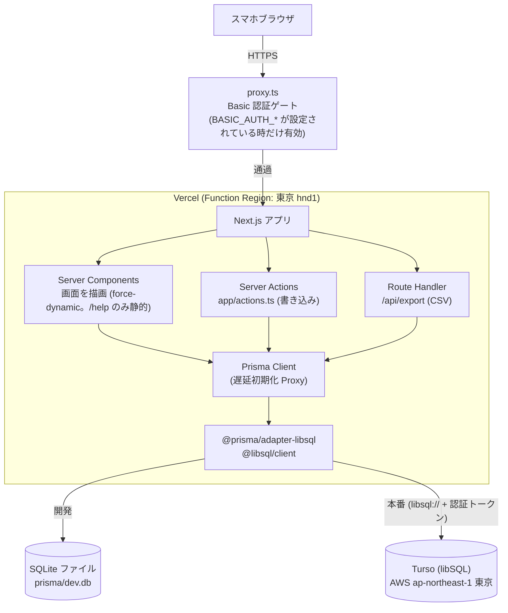

専用の API サーバーは無い。ブラウザから DB へ直接つながる経路も無い。

### 3.2 リクエストの流れ

| 種類 | 流れ |
|---|---|
| 画面表示 | ブラウザ → `proxy.ts` → ページ（Server Component）がクエリを**並列**に実行 → RSC をストリーミング。`app/loading.tsx` のスケルトンが先に届き、本体が後から差し替わる |
| 更新（画面に残る） | クライアントコンポーネントが Server Action を呼ぶ → DB 更新 → `revalidatePath("/", "layout")` → **アクション応答に再描画済みの現在画面が含まれる**（`router.refresh()` 不要） |
| 更新（別画面へ） | Server Action → DB 更新 → `revalidatePath` → `redirect(遷移先)` → 応答に遷移先の描画が含まれる（1リクエストで完結） |
| CSV | `GET /api/export` → Route Handler が Prisma で読み出して CSV を返す |

**画面の表示（読み取り）**

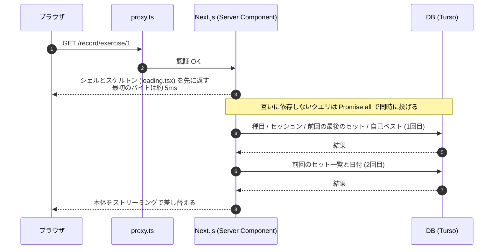

**更新（保存）**

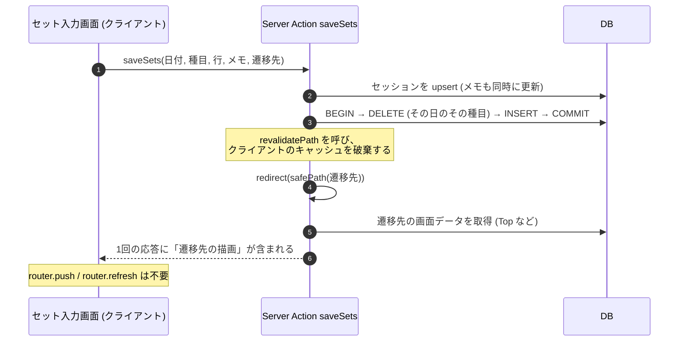

### 3.3 環境変数

| 名前 | 開発 | 本番 | 説明 |
|---|---|---|---|
| `DATABASE_URL` | `file:./prisma/dev.db` | `libsql://<db>-<org>.turso.io` | DB の接続 URL。`TURSO_DATABASE_URL` でも可 |
| `DATABASE_AUTH_TOKEN` | 不要 | Turso のトークン | `TURSO_AUTH_TOKEN` でも可。Prisma CLI 用には `prisma.config.ts` が URL の `?authToken=` に畳み込む |
| `BASIC_AUTH_USER` | 未設定（=認証無効） | 任意の ID | 両方設定された時だけ Basic 認証が有効になる |
| `BASIC_AUTH_PASSWORD` | 未設定 | 任意のパスワード | |
| `APP_TZ_OFFSET_MINUTES` | 既定 `540` | `540` | 「今日」の判定に使う UTC からのオフセット（分）。**消すと UTC 扱いになり日付が9時間ずれる** |

- `.env` は gitignore。`.env.example` をコピーして作る。
- Vercel の Turso 連携を使うと `TURSO_DATABASE_URL` / `TURSO_AUTH_TOKEN` が自動で入る。アプリはどちらの名前でも動く（`lib/db-env.ts`）。

### 3.4 npm スクリプト

| コマンド | 内容 |
|---|---|
| `npm run dev` | 開発サーバー（http://localhost:3000） |
| `npm run build` | `prisma generate && next build`（**マイグレーションは含めない**。§15 D-04） |
| `npm run start` | 本番ビルドの起動 |
| `npm run lint` | ESLint |
| `postinstall` | `prisma generate`（`app/generated/` は gitignore のため、新規クローン・Vercel で必須） |
| `npm run db:migrate` | `prisma migrate dev`（ローカルでスキーマ変更の migration を作って適用。対話式） |
| `npm run db:deploy` | `prisma migrate deploy`（**ローカル SQLite 専用**。Turso には使えない） |
| `npm run db:seed` | 初期種目の投入（冪等） |
| `npm run db:sql` | 空 DB から現スキーマまでの DDL を標準出力へ |
| `npm run db:studio` | Prisma Studio |
| `npm run db:push-turso` | `tsx scripts/setup-turso.ts && prisma db seed`。**Turso へのスキーマ適用＋初期種目投入**（環境変数で Turso を指定して実行） |

---

## 4. リポジトリ構成

```
repz/
├─ README.md                      ★本書（唯一の仕様の正）
├─ AGENTS.md / CLAUDE.md          Next.js 16 向けエージェント規約（CLAUDE.md は AGENTS.md を取り込むだけ）
├─ package.json / package-lock.json
├─ next.config.ts                 serverExternalPackages の指定（§4.1）
├─ proxy.ts                       Basic 認証（§10）
├─ prisma.config.ts               Prisma 7 の設定（スキーマ・migration・seed・接続URL）
├─ postcss.config.mjs / eslint.config.mjs / tsconfig.json   create-next-app の既定（パスエイリアス "@/*" → "./*"）
├─ .env / .env.example / .gitignore
├─ docs/
│  └─ repz-manual.html            運用マニュアル（別管理）
├─ prisma/
│  ├─ schema.prisma               データモデル（§5）
│  ├─ seed.ts                     初期種目（冪等 upsert）
│  ├─ migrations/                 マイグレーション SQL（§5.4）
│  └─ dev.db                      ローカル DB（gitignore）
├─ scripts/
│  └─ setup-turso.ts              Turso へ migration SQL を直接適用（§14.2）
├─ lib/
│  ├─ prisma.ts                   Prisma クライアント（遅延初期化 Proxy）
│  ├─ db-env.ts                   接続情報の解決
│  ├─ date.ts                     日付ユーティリティ（TZ・月曜始まり・表示整形）
│  ├─ calc.ts                     推定1RM・ボリューム・前回比（純粋関数。クライアントからも使う）
│  ├─ format.ts                   fmtKg / fmtKgPrecise
│  └─ queries.ts                  読み取りクエリ全般（§9）
├─ app/
│  ├─ layout.tsx                  ルートレイアウト（ヘッダー・下部の Top リンク・フォント・viewport）
│  ├─ loading.tsx                 遷移中のスケルトン
│  ├─ globals.css                 デザイントークン・共通クラス（§11）
│  ├─ actions.ts                  Server Actions（書き込み全般。§8）
│  ├─ page.tsx                    Top（/）
│  ├─ help/page.tsx               使い方
│  ├─ record/page.tsx             大分類・テンプレート選択
│  ├─ record/[category]/page.tsx  種目選択
│  ├─ record/exercise/[id]/page.tsx   セット入力
│  ├─ record/template/[id]/page.tsx   テンプレートの種目を順に記録
│  ├─ session/[date]/page.tsx     セッション詳細・編集・削除
│  ├─ recent/page.tsx             直近セッションへ転送
│  ├─ volume/page.tsx             週間ボリューム詳細
│  ├─ exercise/[id]/page.tsx      種目別グラフ
│  ├─ body-weight/page.tsx        体重
│  ├─ settings/page.tsx           設定（種目・テンプレート・CSV）
│  ├─ settings/templates/[id]/page.tsx   テンプレート編集
│  ├─ api/export/route.ts         CSV
│  └─ generated/prisma/           prisma generate の出力（gitignore）
└─ components/
   ├─ ui.tsx                      BackLink / SubmitButton / DangerButton
   ├─ BackToTop.tsx               全ページ下部の「← Topに戻る」（"/" では非表示）
   ├─ DayTrainingCard.tsx         今日トレ／直近トレのカード（前回比モード対応）
   ├─ VolumeProgress.tsx          「あと◯kg」＋進捗バー
   ├─ VolumeDiff.tsx              週間ボリュームの前週比
   ├─ SetInputForm.tsx            セット入力フォーム（クライアント）
   ├─ SessionExerciseEditor.tsx   セッション詳細の種目ブロック
   ├─ SessionControls.tsx         セッション削除ボタン
   ├─ MemoEditor.tsx              セッションメモ編集
   ├─ BodyWeightForm.tsx / BodyWeightList.tsx
   ├─ ExerciseAdmin.tsx           種目の追加・改名・並び替え・削除
   ├─ TemplateSection.tsx / TemplateEditor.tsx
   └─ Chart.tsx                   Recharts の折れ線ラッパー
```

**モジュールの依存の向き**（`lib/calc.ts` などの純粋関数は、クライアントからも使うので **prisma を import しない**）

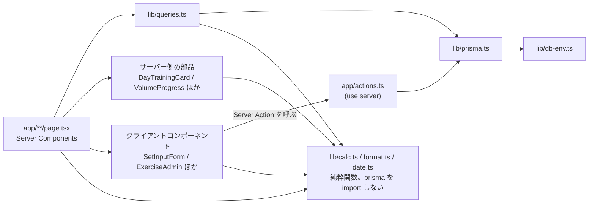

### 4.1 設定ファイルの現物

**`next.config.ts`**

```ts
import type { NextConfig } from "next";

const nextConfig: NextConfig = {
  serverExternalPackages: ["@prisma/adapter-libsql", "@libsql/client", "libsql"],
};

export default nextConfig;
```

**`prisma.config.ts`**

```ts
import path from "node:path";
import { defineConfig } from "prisma/config";

// Prisma 7 は .env を自動読み込みしないため明示的にロードする。
// 既に接続情報がある場合 (CLI で明示指定 / Vercel) は上書きしない。
if (!process.env.DATABASE_URL && !process.env.TURSO_DATABASE_URL) {
  try {
    process.loadEnvFile(path.join(__dirname, ".env"));
  } catch {
    // .env が無い環境では環境変数がそのまま使われる
  }
}

// Turso: 認証トークンが別env (DATABASE_AUTH_TOKEN) にある場合は URL に載せる
// (schema engine は adapter を使わず datasource.url だけを見るため)
function datasourceUrl(): string | undefined {
  const url = process.env.DATABASE_URL || process.env.TURSO_DATABASE_URL;
  const token = process.env.DATABASE_AUTH_TOKEN || process.env.TURSO_AUTH_TOKEN;
  if (!url || !token || url.includes("authToken=") || url.startsWith("file:")) {
    return url;
  }
  return `${url}${url.includes("?") ? "&" : "?"}authToken=${token}`;
}

export default defineConfig({
  schema: path.join("prisma", "schema.prisma"),
  migrations: {
    path: path.join("prisma", "migrations"),
    seed: "tsx prisma/seed.ts",
  },
  datasource: {
    url: datasourceUrl(),
  },
});
```

**`lib/db-env.ts`**

```ts
export function resolveDbConfig(): { url: string; authToken?: string } {
  const url = process.env.DATABASE_URL || process.env.TURSO_DATABASE_URL;
  const authToken =
    process.env.DATABASE_AUTH_TOKEN || process.env.TURSO_AUTH_TOKEN || undefined;
  if (!url) {
    throw new Error("DATABASE_URL (または TURSO_DATABASE_URL) が設定されていません");
  }
  return { url, authToken };
}
```

**`lib/prisma.ts`**（遅延初期化。§15 D-05）

```ts
import { PrismaLibSql } from "@prisma/adapter-libsql";
import { PrismaClient } from "@/app/generated/prisma/client";
import { resolveDbConfig } from "@/lib/db-env";

const globalForPrisma = globalThis as unknown as { prisma: PrismaClient | undefined };

function getPrisma(): PrismaClient {
  if (!globalForPrisma.prisma) {
    const { url, authToken } = resolveDbConfig();
    globalForPrisma.prisma = new PrismaClient({
      adapter: new PrismaLibSql({ url, authToken }),
    });
  }
  return globalForPrisma.prisma;
}

export const prisma = new Proxy({} as PrismaClient, {
  get(_target, prop, receiver) {
    const client = getPrisma();
    const value = Reflect.get(client, prop, receiver);
    return typeof value === "function" ? value.bind(client) : value;
  },
});
```

> アダプタのクラス名は **`PrismaLibSql`**（`PrismaLibSQL` ではない）。生成クライアントの import 先は `@/app/generated/prisma/client`。

### 4.2 `.gitignore`（create-next-app の既定に追加した分）

```
!.env.example          # `.env*` を無視した上で .env.example だけ追跡する
/prisma/*.db
/prisma/*.db-journal
/app/generated
```

---

## 5. データモデル

### 5.1 ER 図

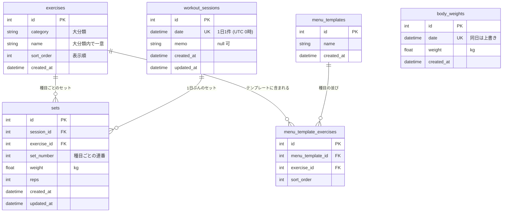

- `sets.session_id` / `sets.exercise_id` / `menu_template_exercises.*` はすべて **ON DELETE CASCADE**。
  - セッションを削除 → そのセット全削除
  - 種目を削除 → その種目の全セットとテンプレート内の該当行も削除
  - テンプレートを削除 → その種目行も削除

### 5.2 `prisma/schema.prisma`（正はこのファイル）

```prisma
// Repz - 筋トレ記録アプリ
// データモデル定義 (README.md「5. データモデル」参照)

generator client {
  provider = "prisma-client"
  output   = "../app/generated/prisma"
}

datasource db {
  provider = "sqlite"
}

/// 種目マスタ
model Exercise {
  id        Int      @id @default(autoincrement())
  category  String // 大分類 (胸/背中/脚/肩/腕/その他)
  name      String
  sortOrder Int      @default(0) @map("sort_order")
  createdAt DateTime @default(now()) @map("created_at")

  sets             Set[]
  templateExercises MenuTemplateExercise[]

  @@unique([category, name])
  @@map("exercises")
}

/// トレーニングセッション (1日1セッション想定)
model WorkoutSession {
  id        Int      @id @default(autoincrement())
  date      DateTime @unique // トレーニング日 (日付のみ利用)
  memo      String?
  createdAt DateTime @default(now()) @map("created_at")
  updatedAt DateTime @updatedAt @map("updated_at")

  sets Set[]

  @@map("workout_sessions")
}

/// セット記録
model Set {
  id         Int      @id @default(autoincrement())
  sessionId  Int      @map("session_id")
  exerciseId Int      @map("exercise_id")
  setNumber  Int      @map("set_number")
  weight     Float // kg
  reps       Int
  createdAt  DateTime @default(now()) @map("created_at")
  updatedAt  DateTime @updatedAt @map("updated_at")

  session  WorkoutSession @relation(fields: [sessionId], references: [id], onDelete: Cascade)
  exercise Exercise       @relation(fields: [exerciseId], references: [id], onDelete: Cascade)

  @@index([sessionId])
  @@index([exerciseId])
  @@map("sets")
}

/// 体重記録 (トレーニングと独立)
model BodyWeight {
  id        Int      @id @default(autoincrement())
  date      DateTime @unique
  weight    Float // kg
  createdAt DateTime @default(now()) @map("created_at")

  @@map("body_weights")
}

/// メニューテンプレート
model MenuTemplate {
  id        Int      @id @default(autoincrement())
  name      String
  createdAt DateTime @default(now()) @map("created_at")

  exercises MenuTemplateExercise[]

  @@map("menu_templates")
}

/// テンプレート種目
model MenuTemplateExercise {
  id             Int @id @default(autoincrement())
  menuTemplateId Int @map("menu_template_id")
  exerciseId     Int @map("exercise_id")
  sortOrder      Int @default(0) @map("sort_order")

  template MenuTemplate @relation(fields: [menuTemplateId], references: [id], onDelete: Cascade)
  exercise Exercise     @relation(fields: [exerciseId], references: [id], onDelete: Cascade)

  @@index([menuTemplateId])
  @@map("menu_template_exercises")
}
```

> **Prisma 7 の注意**: `datasource` に `url` を書けない（P1012）。接続 URL は `prisma.config.ts` に置く。`prisma-client` ジェネレータの出力はプロジェクト内（`app/generated/prisma`）で、コミットしない。

### 5.3 テーブル仕様

| テーブル | 役割 | 主なカラム・制約 |
|---|---|---|
| `exercises` | 種目マスタ | `category`（大分類）、`name`、`sort_order`（大分類内の表示順）。**`(category, name)` は一意** |
| `workout_sessions` | トレーニング日 | `date`（**一意**＝1日1セッション）、`memo`（null 可）。1日に複数回行っても1セッションに統合する運用 |
| `sets` | セット記録 | `session_id`、`exercise_id`、`set_number`（1 始まり）、`weight`（kg、float）、`reps`（int）。`set_number` は種目ごとの連番 |
| `body_weights` | 体重 | `date`（**一意**＝同日は上書き）、`weight`（kg） |
| `menu_templates` | テンプレート | `name` |
| `menu_template_exercises` | テンプレートの種目 | `menu_template_id`、`exercise_id`、`sort_order`（テンプレート内の並び順） |

**セッション（`workout_sessions`）のライフサイクル**

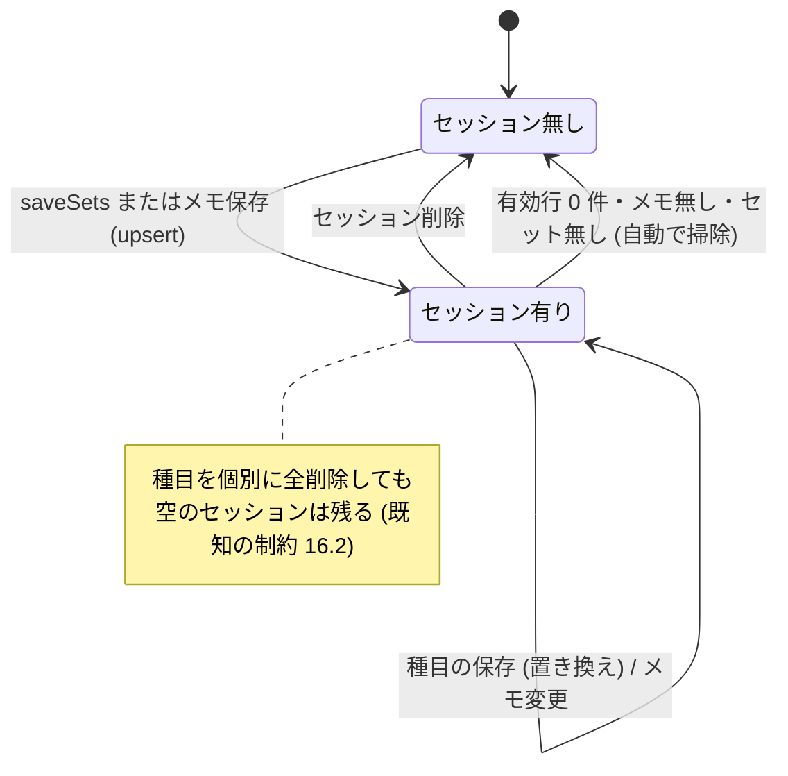

### 5.4 マイグレーション履歴

| ディレクトリ | 内容 |
|---|---|
| `20260905155421_init` | 6 テーブルと索引（`workout_sessions.date` / `body_weights.date` の一意索引、`sets` / `menu_template_exercises` の索引） |
| `20260906021500_exercise_category_name_unique` | `exercises(category, name)` の一意索引を追加 |

- 新しい migration の作り方: `prisma/schema.prisma` を編集 → `npm run db:migrate`（対話式）。
  **非対話環境では `migrate dev` が動かない**ため、`prisma migrate diff --from-migrations prisma/migrations --to-schema prisma/schema.prisma --script` で SQL を出して、`prisma/migrations/<日時>_<名前>/migration.sql` を手で作り、`prisma migrate deploy` で適用する（Prisma 7 では `--from-schema-datamodel` ではなく `--from-migrations` / `--to-schema` 等を使う）。
- Turso へは §14.2 の手順（`npm run db:push-turso`）。

### 5.5 初期種目（38 件）

`prisma/seed.ts` の `INITIAL`。**冪等**（`(category, name)` で upsert。既存の種目・並び順は触らず、不足分だけ追加）。`sort_order` は配列の添字。

| 大分類 | 種目（この順に `sort_order` = 0, 1, …） |
|---|---|
| 胸（7） | ベンチプレス / インクラインベンチプレス / ダンベルプレス / チェストプレス / ダンベルフライ / ペックフライ / ディップス |
| 背中（6） | デッドリフト / 懸垂 / ラットプルダウン / ベントオーバーロウ / シーテッドロウ / ワンハンドロウ |
| 脚（7） | スクワット / レッグプレス / レッグエクステンション / レッグカール / ルーマニアンデッドリフト / カーフレイズ / ブルガリアンスクワット |
| 肩（6） | ショルダープレス / サイドレイズ / フロントレイズ / リアレイズ / アップライトロウ / シュラッグ |
| 腕（7） | バーベルカール / ダンベルカール / ハンマーカール / インクラインカール / トライセプスプレスダウン / スカルクラッシャー / フレンチプレス |
| その他（5） | アブローラー / クランチ / レッグレイズ / プランク / バックエクステンション |

### 5.6 日付の扱い

- 日付は **`"YYYY-MM-DD"` 文字列**で扱い、DB には **UTC 0 時の `DateTime`** として保存する（`dateStrToDate`）。
- 「今日」は `APP_TZ_OFFSET_MINUTES`（既定 540 = JST）を足した時刻の日付（`todayStr`）。Vercel は UTC で動くため、これが無いと日本の深夜〜朝の記録が前日になる。
- 月曜始まりの週頭: `weekStartStr`（日曜は 6 日戻す、それ以外は `1 - 曜日` 日ずらす）。
- 表示用: `formatShort` → `10/25(日)`、`formatLong` → `2026年10月25日(日)`。曜日は `["日","月","火","水","木","金","土"]`。
- `lib/date.ts` の関数: `todayStr` / `dateStrToDate` / `dateToStr` / `addDays` / `weekStartStr` / `formatShort` / `formatLong`。

---

## 6. 計算仕様（ドメインロジック）

純粋関数は `lib/calc.ts`（クライアントからも import される。**prisma を import しない**こと）。

### 6.1 ボリューム

`ボリューム = Σ（重量 kg × 回数）`。セット単位の積を、種目・日・週で合計する。表示は `fmtKg`（整数に丸めて桁区切り、例 `1,300kg`）。

### 6.2 推定1RM（Epley 式）

```ts
estimate1RM(weight, reps) =
  非有限値 → 0 / reps <= 1 → weight / それ以外 → weight * (1 + reps / 30)
```

### 6.3 PR（自己ベスト）判定

- 過去ベスト = その種目の**過去の全セット**の推定1RM の最大値（`getExercisePR`）。入力中の日のセットは除く（`excludeDateStr`）。
- 入力行の推定1RM > 過去ベスト + 0.01 のとき「MAX更新!」。過去ベストが 0（初めての種目）のときは出さない。
- セット入力画面の見出しには「自己ベスト◯kg（推定1RM◯kg）」＝過去の最大重量と最大推定1RM（小数1桁）を出す。

### 6.4 週間ボリュームと前週比

- 週 = 月曜〜日曜。`getWeeklyVolume(基準日)` は「基準日を含む週」と「その前の週」を並列取得。
- 種目別行は **ボリューム降順**。`sets` は件数。
- `diffPct = 前週合計 > 0 ? (今週 − 前週) / 前週 × 100 : null`。`null` のときは「（比較データなし）」。表示は `▲ +12.3%` / `▼ -4.0%`（0 以上は ▲・緑、負は ▼・赤）。
- 週間ボリューム詳細 `/volume?w=` は 0（今週）〜 -52 に丸める。

### 6.5 前回値（セット入力の初期値）

- 「前回」＝**その種目を、その日より前に最後に行った日**のセット（`getPreviousSetsForExercise`）。直近のセッションが別部位でも、その種目の前回を探す。
- 初期値の決め方: ① その日にすでに保存したセットがあればそれ → ② 無ければ前回のセットをコピー → ③ どちらも無ければ `{weight: 20, reps: 10}` の1行。
- 「＋ セット追加」は、前回の同じセット番号 → 無ければ現在の最後の行 → 無ければ `{20, 10}` をコピーして追加。

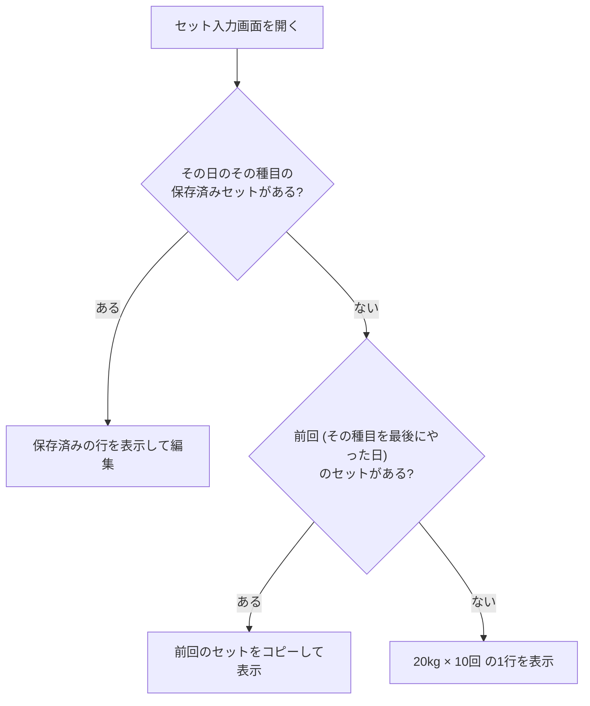

### 6.6 前回比（プログレッシブオーバーロード）

```ts
compareVolume(current, previous) = {
  diff:  round((current - previous) * 10) / 10,    // 小数1桁
  kind:  diff > 0 ? "exceeded" : diff < 0 ? "short" : "equal",
  ratio: previous > 0 ? current / previous : 0,
}
```

**比較の基準は「直近トレ」ではなく「同じ種目の前回」**。直近トレが別部位の日（胸の日の翌日が背中の日など）でも、種目ごとに比べられる（§15 D-09）。

- **種目の前回**: その種目を最後に行った日（今日より前）のボリューム合計（`getPreviousExerciseTotals`）。
- **比較から除く種目**: 前回の記録が無い（＝初回）、または前回のボリュームが 0（自重など 0kg の種目）。
- **今日トレの合計の比較**: 「比較できる種目」だけの今日の合計 vs 同じ種目の前回合計。比較できない種目があるときは見出しに「（初回の種目を除く）」を付ける。
- **文言と色**（`VolumeProgress`）。トレ中は未達が普通なので、未達を赤（マイナス表示）にしない（§15 D-10）。

| 状態 | 文言 | 文字色 | バー |
|---|---|---|---|
| 超えた（diff > 0） | `+◯kg 前回超え`（種目行は `▲ +◯kg`） | `good`（緑） | `good` |
| 同じ（diff = 0） | `前回と同じ` | `muted` | `primary` |
| 未達（diff < 0） | `あと ◯kg` | `accent`（水色） | `primary` |

- バーの幅 = `min(100, round(ratio × 100))%`。差の表示は `fmtKgPrecise`（小数1桁まで。例 `2.5kg`、`80kg`）。
- セット入力画面は `→ ` を頭に付ける（例 `この種目 前回1,300kg（10/15(木)） → あと 80kg`）。

**種目ごとの判定の流れ**

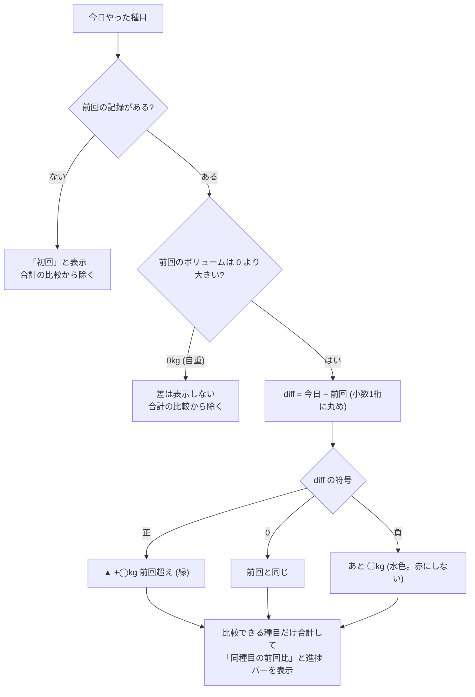

### 6.7 大分類の並び順

`["胸","背中","脚","肩","腕","その他"]` の順。DB にあるそれ以外の大分類は名前順で末尾。

### 6.8 カテゴリ名・種目名の一意性

同じ大分類内の同名種目は作れない（追加・改名とも、重複なら黙ってスキップ）。

---

## 7. 画面仕様

全画面 `export const dynamic = "force-dynamic"`（`/help` を除く）。Next 16 の動的ルートは `params` / `searchParams` が **Promise**（`await` する）。型は `PageProps<"/route">` / `LayoutProps<"/">`（`next build` が生成するルート型。`tsc` 単体では未生成の間エラーになる）。

**画面遷移図**

記録の流れ:

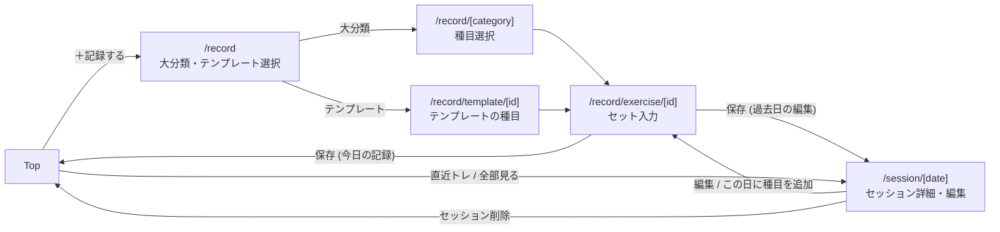

その他の画面:

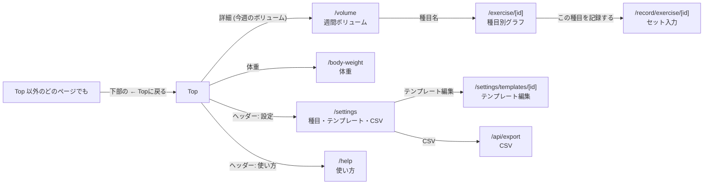

### 7.0 共通

**ルートレイアウト（`app/layout.tsx`）**

- `<html lang="ja">`、フォントは `next/font/google` の Geist / Geist Mono（`--font-geist-sans` / `--font-geist-mono`）。
- metadata: title `repz`、description `筋トレ記録アプリ`。viewport: `themeColor #0b0f14`、`width device-width`、`initialScale 1`、`maximumScale 1`。
- ヘッダー（sticky、`border-b`、`bg-background/90` + blur）: 左に `repz`（`r` だけ `primary` 色）＝Top へのリンク、右に **「使い方」→ `/help`**、**「設定」→ `/settings`**。
- `<main>` は `max-w-md`、`px-4 py-4`。children の後ろに `<BackToTop />`。

**下部の「← Topに戻る」**（`BackToTop`、クライアント）: `usePathname()` が `/` 以外のとき、全幅の `btn`（`mt-8 w-full justify-center text-muted`）を表示。

**遷移中のスケルトン**（`app/loading.tsx`）: `role="status" aria-busy="true" aria-label="読み込み中"`。細いバー2本＋カード3枚の `animate-pulse`（`motion-reduce` で無効）。

**`BackLink`**: 画面上部の「← ラベル」。直前の階層へ戻る（Top 直行ではなく1つ上）。Top 直行は下部の `BackToTop` が担う。

### 7.1 Top（`/`）

上から次の順。

1. 日付（`formatLong(今日)`）
2. ボタン: **「＋ 記録する」**（primary、`/record`）／「直近トレ」「体重」の2列。直近トレは `recentDate ? /session/{recentDate} : /recent`（`/recent` 経由のリダイレクトで通信が2回直列になるのを避ける）
3. **今日トレ**（`DayTrainingCard`、前回比モード）— 今日のセッションに**セットが1件以上**あるときだけ表示
4. **直近トレ**（`DayTrainingCard`、通常モード）— 今日より前で最新のセッション。無ければ「まだ記録がありません」
5. **今週のボリューム** — 見出し＋「詳細 →」（`/volume`）、`VolumeDiff`、上位5種目（大分類チップ＋種目名／`ボリューム / ◯set`）。無ければ「今週はまだ記録がありません」
6. **体重** — 最新体重（`YYYY-MM-DD 時点`）。未記録は `–`

**`DayTrainingCard` の表示**

- ヘッダー: タイトル、右に「全部見る →」（`/session/日付`）。
- 日付（`formatLong`）と、右に **「その日のトータル ◯kg」**。
- **通常モード（直近トレ）**: 種目ごとに1行 `種目名 …… 最大重量60kg / トータル1,300kg`。
- **前回比モード（今日トレ）**: 比較行 `同種目の前回比 …… あと 30kg` ＋ 進捗バー、続けて種目ごとに2行:
  - 1行目: 種目名 ＋ 右に差（`▲ +50kg` 緑／`あと 80kg` 水色／`前回と同じ`／`初回`。前回あり・0kg の自重種目は何も出さない）
  - 2行目（小・muted）: `最大重量60kg / トータル1,350kg（前回 1,300kg）`。前回が比較対象外なら括弧は付けない
- 種目の並びは `exerciseId` 昇順、セットは `setNumber` 昇順。

### 7.2 使い方（`/help`）

静的ページ。**利用者向けの使い方だけ**を載せる（記録の4ステップ、推定1RM の式、今日トレ・直近トレの見方と前回比、週間ボリューム、体重、編集・削除、設定、バックアップの注意）。技術スタック・運用・トークンの話は載せない（URL を人に見せたときに構成や版が見えるのを避けるため。運用の話は `docs/repz-manual.html`）。

### 7.3 記録の導線

**`/record`**: 「記録する」。`?date=YYYY-MM-DD`（今日以外）が付くと、見出しに日付チップを出し、戻り先を `/session/日付` にし、テンプレート欄は出さない。
- 「メニューから選ぶ」: テンプレートごとのボタン（`📋 名前`、2列）→ `/record/template/[id]`
- 「大分類から選ぶ」: 大分類ごとの大きなボタン（種目数付き、2列）→ `/record/{大分類}`（`?date` を引き継ぐ）

**`/record/[category]`**: 種目ボタンの縦リスト（`sort_order` 昇順）。種目が無い大分類は 404。→ `/record/exercise/{id}`（`?date` 引き継ぎ）。

**`/record/template/[id]`**: テンプレートの種目を順番にボタン表示（大分類チップ付き）。→ `/record/exercise/{id}`。種目が無ければ案内文。存在しなければ 404。

### 7.4 セット入力（`/record/exercise/[id]`）

`?date=` があればその日付、無ければ今日。**4つのクエリ（種目・その日のセッション・前回セット・自己ベスト）を同時に取得**し、種目が無ければ 404。

- 上部: `BackLink`（今日なら大分類へ、過去日なら `/session/日付` へ）、大分類チップ、種目名、`記録日: M/D(曜)`、`前回 M/D(曜): 重量×回数 / …`、`自己ベスト ◯kg（推定1RM ◯kg）`（過去記録がある場合）。
- **前回比バー**（前回のボリュームが 0 より大きいときだけ）: `position: sticky`（ヘッダー直下、`top-[3.4rem]`、`z-[5]`）。ラベル `この種目 前回{合計}kg（M/D(曜)）`、右に `→ あと ◯kg` ／ `→ +◯kg 前回超え` ／ `→ 前回と同じ`。入力中の合計は、回数が空欄・0 のセットを除いて計算。
- **セットカード**（行ごと）:
  - 見出し `{n} セット目`、PR のとき `MAX更新!` バッジ、`削除`（行が1つのときは無効）
  - その番号の前回があれば `前回: ◯kg × ◯rep`
  - 重量: `−2.5`｜数値入力（`step 0.5`、`inputMode=decimal`、末尾に `kg`）｜`+2.5`（0 未満にならない）
  - 回数: `−1`｜数値入力（`inputMode=numeric`、末尾に `rep`）｜`+1`（0 未満にならない）
- 「＋ セット追加」（点線ボタン）。
- メモ欄 `メモ（セッション共通）`（placeholder `調子・気づきなど`）。
- **「保存する」**（primary、保存中は `保存中…` で無効）→ Server Action `saveSets`。メモは**変更があるときだけ**送る。

**保存後の遷移**: 今日の記録は **Top（`/`）**、過去日（`?date=`）の編集は `/session/日付`。サーバー側 `redirect` で行う（§8）。

### 7.5 セッション詳細（`/session/[date]`）

日付形式が不正、またはその日のセッションが無ければ 404。

- 日付（`formatLong`）と、右に**その日のトータルボリューム**。
- 種目ごとのブロック（`SessionExerciseEditor`）: 大分類チップ・種目名・**編集**（→ `/record/exercise/{id}?date=日付`）、セットの表（`n｜◯kg × ◯rep`）、下に `ボリューム ◯kg / 推定1RM ◯kg` と **種目を削除**（確認ダイアログ）。
- 種目が無ければ「この日の種目記録はありません。」
- **＋ この日に種目を追加**（点線、→ `/record?date=日付`）。1日に複数回ジムへ行ったとき、後から追記して統合するために使う。
- メモ編集（`MemoEditor`）: 変更があるときだけ「メモを保存」が有効。
- **このセッションを削除**（確認ダイアログ → 削除して Top へ）。

**`/recent`**: 今日より前の最新セッションがあれば `/session/日付` へ `redirect`。無ければ「まだ過去の記録がありません。」と「記録する」ボタン。

### 7.6 週間ボリューム（`/volume`）と種目別グラフ（`/exercise/[id]`）

**`/volume?w=N`**: 前週／翌週ボタン（今週より先へは進めない）、週の範囲（`M/D(月) – M/D(日)`）、`VolumeDiff`（今週 vs 前週）、種目別リスト（大分類チップ＋種目名→`/exercise/{id}`、`ボリューム / ◯set`）。無ければ「この週の記録はありません」。

**`/exercise/[id]`**: 戻り先は `/volume`。大分類チップ・種目名・自己ベスト。「この種目を記録する」ボタン。**重量推移**の折れ線（MAX 重量＝`#ff5a1f`、推定1RM＝`#38bdf8`。日付ごとに最大値）。**最近の記録**（新しい順に12件、`M/D(曜)｜MAX ◯kg / vol ◯kg`）。

### 7.7 体重（`/body-weight`）

- 入力: 日付（既定は今日、未来不可）、体重（`−` / `＋` で 0.1kg、既定は最新の体重、無ければ 60）、「体重を記録」。同じ日は上書き。
- **推移**: 折れ線（`#38bdf8`）、右上に期間の増減（最初→最新。減少=緑、増加=赤）。
- **記録一覧**（新しい順）: `M/D(曜)｜◯kg｜前の記録との差（0 以下=緑／増=赤）｜×`（削除、確認ダイアログ）。

### 7.8 設定（`/settings`）

- **種目**（`ExerciseAdmin`）: 「種目を追加」（大分類のセレクト＋種目名＋追加。大分類の選択肢は既定6種＋DBにあるもの）。大分類ごとに、`▲▼`（同大分類内で入れ替え）、名前の入力欄（**フォーカスが外れたとき**に保存）、`×`（確認ダイアログ「過去の記録も削除されます」）。
- **メニューテンプレート**（`TemplateSection`）: 一覧（`📋 名前`、種目名を `・` で連結、「編集」「削除」）、「テンプレートを作成」（名前＋作成 → 編集画面へ遷移）。
- **データ**: 「⬇ トレーニング記録 CSV」「⬇ 体重記録 CSV」。
- **認証について**（`BASIC_AUTH_*` で有効化される旨の注記）。

**`/settings/templates/[id]`**（`TemplateEditor`）: テンプレート名（フォーカスが外れたとき保存）、「含まれる種目」（`▲▼×`。変更のたびに全置換で保存）、「種目を追加」（大分類ごとの `＋ 種目名` チップ。選択済みは出ない）。

### 7.9 CSV（`/api/export`）

- 既定: トレーニング記録。列 `date, category, exercise, set_number, weight_kg, reps, volume_kg, session_memo`。並びは セッション日 → `exerciseId` → `setNumber`。`volume_kg = weight × reps`（小数2桁）。ファイル名 `repz-workouts-YYYY-MM-DD.csv`。
- `?type=bodyweight`: 列 `date, weight_kg`。ファイル名 `repz-bodyweight-YYYY-MM-DD.csv`。
- UTF-8 の **BOM 付き**（Excel でそのまま開ける）、改行 CRLF、`"` `,` 改行を含むセルは `"` で囲んでエスケープ。

---

## 8. サーバー処理（Server Actions / Route Handler）

すべて `app/actions.ts`（`"use server"`）。共通ルール:

- 書き込み後は **`revalidatePath("/", "layout")`**。Server Function 内では「現在の画面を即時更新」し、**訪問済みページのクライアントキャッシュも破棄**する（戻る/進むで古い画面が出るのを防ぐ。§15 D-07）。
- 画面に留まる操作は、アクション応答に再描画が含まれるので**クライアントで `router.refresh()` を呼ばない**。
- 別画面へ移る操作は `redirect()`。遷移先は **`safePath()`** で検証（`/` で始まり `//` や `/\` で始まらないアプリ内パスのみ。不正なら `/`）。

| アクション | 引数 | 処理 |
|---|---|---|
| `saveSets` | `dateStr, exerciseId, rows[{weight,reps}], memo \| undefined, redirectTo` | ①セッションを `upsert`（メモが渡されたらここで更新。`undefined` は触らない、空文字は消去）②有効な行（有限値・`reps>0`）だけに `setNumber` を 1 から振り、`$transaction([deleteMany(その日のその種目), createMany])` で**置き換え** ③有効行が 0 件でメモも無く、セッションにセットが残らなければセッションを削除 ④`revalidatePath` ⑤`redirect(safePath(redirectTo))` |
| `deleteSessionExercise` | `sessionId, exerciseId` | その日のその種目のセットを全削除 |
| `updateSessionMemo` | `dateStr, memo` | `upsert` でメモ更新。空にしてセットも無ければセッション削除 |
| `deleteSession` | `id` | セッション削除（セットはカスケード）→ `redirect("/")` |
| `updateSet` / `deleteSet` | | セット単体の更新・削除。**現在 UI からは未使用**（予備） |
| `addExercise` | `category, name` | 空は無視。同大分類・同名は無視。`sort_order` = 大分類内の最大 + 1 |
| `renameExercise` | `id, name` | 空・同名・重複は無視 |
| `deleteExercise` | `id` | 種目削除（セットとテンプレート行もカスケード） |
| `moveExercise` | `id, "up"\|"down"` | 同大分類内で隣と `sort_order` を入れ替え（トランザクション） |
| `saveBodyWeight` | `dateStr, weight` | `weight > 0` のみ。日付で `upsert` |
| `deleteBodyWeight` | `dateStr` | 削除（無くても無視） |
| `createTemplate` | `name` | 作成 → `redirect("/settings/templates/{id}")` |
| `renameTemplate` | `id, name` | 空は無視 |
| `deleteTemplate` | `id` | 削除 → `redirect("/settings")` |
| `setTemplateExercises` | `templateId, exerciseIds[]` | 全置換（`sortOrder` = 配列の添字）をトランザクションで |

**`saveSets` の処理フロー**

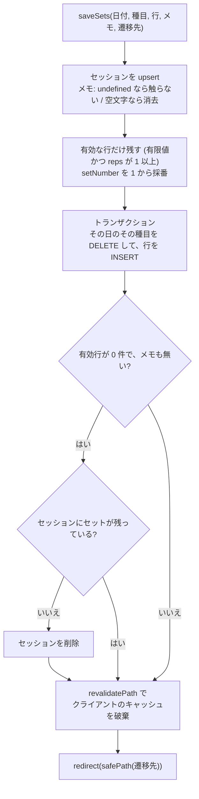

**Route Handler**: `GET /api/export`（§7.9）。

---

## 9. データアクセス層とレスポンス設計

### 9.1 原則

画面の表示時間は、描画自体（5〜12ms）ではなく **「DB への直列の往復回数 × Vercel と DB の距離」** で決まる（調査は §18.1）。したがって:

1. **Vercel の Function Region を DB と同じ地域にする**（現在 hnd1 = Turso の AWS 東京）。
2. **Prisma の `include` / リレーション `select` を使わない**。SQLite では別クエリ（＝直列）に分解される。フラットなクエリを **`Promise.all` で並列**に投げ、種目（約40行）との結び付けは JS 側で行う。
3. 画面ごとの直列の往復数は **1〜2 回**に収める。
4. 更新は Server Action 内で完結させ、`router.push` / `router.refresh` を重ねない。

### 9.2 `lib/queries.ts` の関数

| 関数 | 返すもの | 直列の往復 |
|---|---|---|
| `getExerciseMap`（`React.cache`） | 全種目の `Map<id, Exercise>`（リクエスト内で1回だけ取得） | 1 |
| `getCategoriesWithCounts` | 大分類と種目数（正規順） | 1 |
| `getExercisesByCategory` / `getAllExercises` / `getExercise` | 種目 | 1 |
| `getSessionByDate(date)` | セッション＋`sets`（各セットに `exercise`）。無ければ `null` | 1（セッション・セット・種目マップを並列） |
| `getRecentSession(beforeDate)` | 指定日より前で最新のセッション＋`sets` | 2（セッション取得 → セット取得） |
| `getPreviousSetsForExercise(exId, beforeDate)` | その種目を最後にやった日のセットと日付 | 2 |
| `getPreviousExerciseTotals(date)` | 指定日にやった各種目の「前回の日付とボリューム合計」（`Record<exId, {date, volume}>`） | 1 |
| `getExercisePR(exId, excludeDate?)` | `{best1RM, maxWeight}` | 1 |
| `getWeeklyVolume(基準日)` | 今週の種目別行・今週/前週合計・`diffPct` | 1（2週分と種目マップを並列） |
| `getExerciseHistory(exId)` | 日付ごとの `maxWeight` / `best1RM` / `volume`（古い順） | 1 |
| `getBodyWeights` | 体重（古い順） | 1 |
| `getTemplates` / `getTemplate(id)` | テンプレート＋種目（`exercises[].exercise`） | 1 |
| `groupSetsByExercise` / `orderCategories` / `estimate1RM` | 純粋関数 | — |

**`getPreviousExerciseTotals` の工夫**: 「今日やった種目」をリレーションフィルタ（`exercise: { sets: { some: { session: { date } } } }`）で DB 側に絞るので、今日のセッションの取得を待たずに他のクエリと**並列**に投げられる。

### 9.3 画面ごとの往復数（現状）

| 画面 | 直列の往復 |
|---|---|
| `/` | 2 |
| `/record` / `/record/[category]` / `/session/[date]` / `/volume` / `/exercise/[id]` / `/body-weight` / `/settings` | 1 |
| `/record/exercise/[id]` | 2 |
| `/help` | 0（静的） |

**例: セット入力画面のクエリ（変更前 → 変更後）**

変更前（直列 5 往復）:

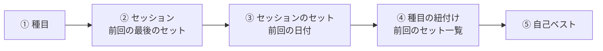

変更後（直列 2 往復。同じ箱の中は同時に実行）:

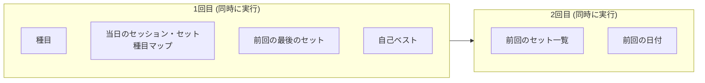

保存（`saveSets`）は直列 5〜6 回（upsert → BEGIN → DELETE → INSERT → COMMIT →（遷移先の描画））。Prisma の `$transaction([...])` は libsql アダプタ上で BEGIN/各文/COMMIT が別往復になる。リージョンを揃えた現状では差が小さいため、生 SQL の `batch` 化は見送り（§15 D-06）。

---

## 10. 認証

`proxy.ts`（Next 16 の Proxy。旧 middleware。**関数名は `proxy`**）。

```ts
import { NextRequest, NextResponse } from "next/server";

export function proxy(req: NextRequest) {
  const user = process.env.BASIC_AUTH_USER;
  const pass = process.env.BASIC_AUTH_PASSWORD;
  if (!user || !pass) return NextResponse.next();          // 未設定 = 認証無効（ローカル開発）

  const header = req.headers.get("authorization");
  if (header?.startsWith("Basic ")) {
    const decoded = atob(header.slice(6));
    const idx = decoded.indexOf(":");
    const u = decoded.slice(0, idx);
    const p = decoded.slice(idx + 1);
    if (u === user && p === pass) return NextResponse.next();
  }

  return new NextResponse("Authentication required", {
    status: 401,
    headers: { "WWW-Authenticate": 'Basic realm="repz", charset="UTF-8"' },
  });
}

export const config = {
  // 静的アセットと Next 内部リクエストは除外
  matcher: ["/((?!_next/static|_next/image|favicon.ico).*)"],
};
```

**判定の流れ**

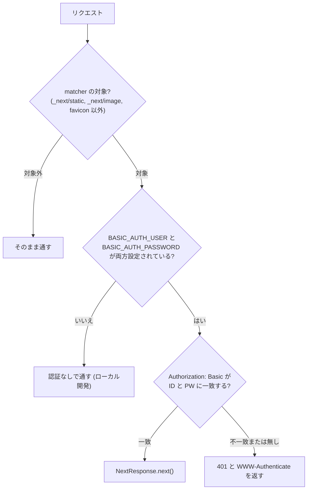

- ID/PW は Base64（暗号化ではない）で送られるので **HTTPS 前提**（Vercel は HTTPS）。推測されにくいパスワードにする。
- 共有 ID/PW の1組のみ。ユーザー別のデータ分離は無い。
- 本番で `*.vercel.app` が Vercel の SSO（Deployment Protection）へリダイレクトされることがある。これは Basic 認証とは別の保護。意図した設定かを確認しておく。

---

## 11. UI デザインシステム

ダーク固定（`html { color-scheme: dark }`）。ライト対応はしない。

### 11.1 色トークン（`app/globals.css`）

| トークン | 値 | 用途 |
|---|---|---|
| `--background` | `#0b0f14` | ページ背景 |
| `--surface` | `#151b23` | カード |
| `--surface-2` | `#1e2732` | ボタン・入力・バーの地 |
| `--border` | `#2a3441` | 罫線 |
| `--foreground` | `#e8edf2` | 本文 |
| `--muted` | `#93a1b0` | 補助テキスト |
| `--primary` / `--primary-fg` | `#ff5a1f` / `#ffffff` | 主ボタン・PR バッジ・進捗バー・ロゴの `r` |
| `--accent` | `#38bdf8` | リンク・未達の「あと◯kg」・体重グラフ |
| `--good` | `#34d399` | 増加・前回超え |
| `--bad` | `#f87171` | 減少・削除 |

`@theme inline` で `--color-*` に写し、Tailwind のユーティリティ（`bg-surface`、`text-muted` など）で使う。`--font-sans` は Geist、日本語は `system-ui, "Hiragino Sans", "Noto Sans JP"` にフォールバック。

### 11.2 共通クラス（`@layer components`）

| クラス | 内容 |
|---|---|
| `.card` | `rounded-2xl border border-border bg-surface p-4` |
| `.btn` | 角丸 xl・`px-4 py-3`・太字・`border-border bg-surface-2`・押下で `scale-[0.99]` |
| `.btn-primary` / `.btn-ghost` / `.btn-sm` | 主（オレンジ）／枠なし（muted）／小 |
| `.field` | 入力欄（`bg-surface-2`、フォーカスで枠が `accent`） |
| `.chip` | 小さな丸バッジ（大分類など） |

数値入力のスピナーは非表示（`::-webkit-*-spin-button`、`-moz-appearance: textfield`）。

### 11.3 グラフ（`components/Chart.tsx`）

Recharts の `LineChart`。`CartesianGrid` は `#2a3441` の破線、軸文字は `#93a1b0`（11px）、X軸は `YYYY-MM-DD` の先頭5文字を落として `MM-DD`、`isAnimationActive={false}`、`connectNulls`。ツールチップは `#151b23` 背景・`#2a3441` 枠。データが空のときは「データがありません」。データは2点以上で線になる。

### 11.4 アクセシビリティ

進捗バーは `role="progressbar"` と `aria-valuenow/min/max`・`aria-label`（`{ラベル} {状態}`）。スケルトンは `role="status" aria-busy="true"`。アニメーションは `motion-reduce` で止める。

---

## 12. 開発手順と検証

### 12.1 ローカル起動

```bash
npm install                    # postinstall で prisma generate
cp .env.example .env           # DATABASE_URL は file:./prisma/dev.db のまま。BASIC_AUTH_* はコメントアウトで無効化
npm run db:migrate             # 初回は dev.db を作成して migration を適用（対話式）
npm run db:seed                # 初期種目38件
npm run dev                    # http://localhost:3000
```

ローカルで DB を作り直したいときは `prisma/dev.db` を消して `npx prisma migrate deploy`（非対話）→ `npm run db:seed`。dev サーバーや Prisma Studio が DB ファイルを掴んでいると消せない（その node プロセスだけを止める）。

### 12.2 品質ゲート（コミット前）

```bash
npx tsc --noEmit        # 型（PageProps 等は next build 後に生成される）
npx eslint .
npm run build
```

### 12.3 動作確認チェックリスト（受け入れ）

1. 起動直後（記録なし）: Top に「直近トレ」「今週のボリューム」「体重」が出て、今日トレは出ない。
2. 記録: 大分類→種目→セット入力。初期値は前回（無ければ 20kg×10）。`±2.5` `±1` が効く。保存で **Top に遷移**し、今日トレに出る。
3. 前回比: 同じ種目を2日に分けて記録し、前回より増やすと「▲ +◯kg」、減らすと「あと ◯kg」。セット入力上部のバーが入力に合わせて「あと → 前回と同じ → +◯kg 前回超え」と変わる。前回が別部位の日でも種目ごとに比べられる。
4. 初回の種目は「初回」、0kg の種目は差を出さず、合計比較からも除かれる。
5. PR: 過去ベストを超える重量・回数を入れると `MAX更新!`。初めての種目では出ない。
6. 過去日の編集: セッション詳細 → 種目の「編集」→ 保存で `/session/日付` に戻る。「この日に種目を追加」も同様。
7. メモ: 保存で反映。空にしてセットも無ければセッションごと消える。
8. 週間ボリューム: 月曜始まり。今週 vs 前週の差分%。`/volume?w=-1` で前週へ。
9. 体重: 同日は上書き。グラフ・増減・削除。
10. 設定: 種目の追加（重複は無視）・改名（フォーカスを外すと保存）・▲▼・削除。テンプレートの作成・編集・削除、記録画面の「メニューから選ぶ」。
11. CSV: 2種類ダウンロードでき、Excel で文字化けしない。
12. 全ページ（Top 以外）の下部に「← Topに戻る」。
13. 認証: 本番または `BASIC_AUTH_*` を設定した状態で、未入力は 401、正しい ID/PW で表示。
14. 遷移: 各リンクで一瞬スケルトンが出てから本体に切り替わる。

### 12.4 Server Action を HTTP で直接検証する方法

ブラウザ描画に依存せず保存処理を検証したいとき。

1. `npm run build` 後、`.next/server/server-reference-manifest.json` の `node` から `exportedName` が目的のアクションのキーを探す（アクション ID）。
2. 本番ビルドを起動し、対象ページに POST する。ヘッダーは `Next-Action: <ID>`、`Content-Type: text/plain;charset=UTF-8`、`Accept: text/x-component`。本文は引数の JSON 配列。**`undefined` は文字列 `"$undefined"`** と書く（`null` は想定外で 500 になる）。
3. 遷移するアクションは応答ヘッダー `x-action-redirect: /path;push` で確認できる。
4. Windows の Git Bash では日本語を直接送ると文字コードが崩れる。JSON の `\uXXXX` エスケープか ASCII を使う。引数の `/` が変換されるときは `MSYS_NO_PATHCONV=1`。

### 12.5 開発環境の注意（Windows）

- 他のプロジェクトの node を巻き込まないよう、テスト用サーバーは**ポート指定で止める**（`Get-NetTCPConnection -LocalPort N` → `Stop-Process`）。`pkill` は効かない。
- 計測・検証用の一時ファイルは検証後に必ず消し、テストデータも戻す（種目 38 件のみの状態）。
- `README.html` 等、エディタの Markdown エクスポートが作る派生ファイルはコミットしない（`git add` は対象ファイルを指定する）。

---

## 13. 再構築手順（ゼロから作り直す）

> 前提: Node.js 24 / npm、GitHub・Vercel・Turso のアカウント。以降、各章を参照しながら実装する。

1. **雛形**: `npx create-next-app@latest repz --typescript --tailwind --app --no-src-dir --use-npm --eslint --import-alias "@/*"`（Next 16 / React 19 / Tailwind 4）。生成された `AGENTS.md` の指示（同梱ドキュメントを読む）に従う。
2. **依存**: `npm i @prisma/client@7.10.0 @prisma/adapter-libsql @libsql/client recharts` と `npm i -D prisma@7.10.0 tsx`（**prisma と @prisma/client は 7.10.0 に揃える**）。
3. **`.gitignore` と `.env`**: §4.2 と §3.3。`.env.example` を作る。
4. **Prisma**: `prisma/schema.prisma`（§5.2）、`prisma.config.ts`（§4.1）。`datasource` に `url` を書かない。`npx prisma migrate dev --name init`（`--skip-generate` は Prisma 7 に無い）→ `npx prisma generate`。`package.json` に §3.4 のスクリプトを追加。
5. **seed**: `prisma/seed.ts`（§5.5、冪等 upsert）→ `npm run db:seed`。続いて `exercises(category, name)` の一意制約の migration（§5.4）。
6. **共通ライブラリ**: `lib/date.ts`（§5.6）、`lib/calc.ts` / `lib/format.ts`（§6）、`lib/db-env.ts` / `lib/prisma.ts`（§4.1。**遅延初期化**）、`next.config.ts`（`serverExternalPackages`）。
7. **データ層**: `lib/queries.ts`（§9。`include` を使わず並列）。
8. **認証**: `proxy.ts`（§10）。
9. **書き込み**: `app/actions.ts`（§8）。
10. **UI の土台**: `app/globals.css`（§11）、`app/layout.tsx`、`app/loading.tsx`、`components/ui.tsx`、`components/BackToTop.tsx`。
11. **画面**（§7）: Top（`DayTrainingCard`・`VolumeProgress`・`VolumeDiff`）→ 記録系（`record/*`、`SetInputForm`）→ `session/[date]` 系（`SessionExerciseEditor`・`MemoEditor`・`SessionControls`）→ `volume` / `exercise/[id]`（`Chart`）→ `body-weight` → `settings` 系（`ExerciseAdmin`・`TemplateSection`・`TemplateEditor`）→ `api/export` → `help`。
12. **検証**: §12.2 の品質ゲートと §12.3 のチェックリスト。
13. **デプロイ**: §14.1。
14. **運用文書**: `docs/repz-manual.html`（任意。本書の §14 を元に図解）。

**つまずきやすい点**（詳細は §16）: Prisma 7 の `url` の置き場所、`PrismaLibSql` の綴り、`prisma migrate deploy` が Turso に届かない（P1013）、`middleware.ts` → `proxy.ts`、Prisma クライアントの即時生成でビルドが落ちる、`include` による直列化。

---

## 14. デプロイと運用

### 14.1 初回構築

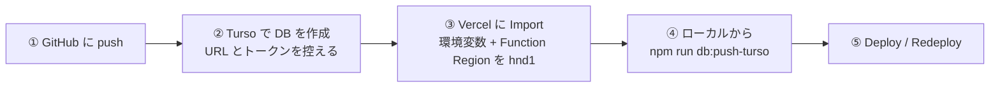

1. **GitHub**: 空のリポジトリ（private）を作って push（ブランチ名は `main`。create-next-app は `master` で作ることがある → `git branch -m master main`）。
2. **Turso**: DB `repz` を作成（グループ `default`、AWS ap-northeast-1 東京）。DB 詳細の **Connect** で URL（`libsql://…turso.io`）、**Create Token** で認証トークンを取得（再表示できないので控える）。
3. **Vercel**: GitHub のリポジトリを Import。**Settings → Environment Variables** に `DATABASE_URL` / `DATABASE_AUTH_TOKEN` / `BASIC_AUTH_USER` / `BASIC_AUTH_PASSWORD` / `APP_TZ_OFFSET_MINUTES=540`。**Settings → Functions → Function Region を東京 hnd1**（DB と同じ地域。変更後は再デプロイが必要。Hobby は1リージョンまで）。
4. **スキーマ適用＋初期種目**（ローカルから1回）:

   ```powershell
   $env:DATABASE_URL = "libsql://repz-xxxx.turso.io?authToken=<トークン>"
   npm run db:push-turso
   ```

   ```bash
   export DATABASE_URL="libsql://repz-xxxx.turso.io?authToken=<トークン>"
   npm run db:push-turso
   ```

   `applied N migration(s)` と `exercises total: 38` が出れば成功。
5. Vercel で Deploy。ビルドは `prisma generate && next build` のみで、**DB に接続しない**ので、環境変数が未設定でも通る。

### 14.2 `scripts/setup-turso.ts`（Turso へのスキーマ適用）

Prisma 7 のスキーマエンジンは `libsql://` に接続できず、`prisma migrate deploy` が **P1013**（"scheme is not recognized"）で失敗する。そのため `@libsql/client` で migration を直接流し込む。

1. `DATABASE_URL`（`?authToken=` 付き可）と `DATABASE_AUTH_TOKEN` から接続。`file:` の URL は拒否（ローカルは `db:migrate` を使う）。
2. `_prisma_migrations` テーブルを無ければ作成（Prisma 標準と同じ列）。
3. `prisma/migrations/` の各ディレクトリを名前順に走査し、**未適用のものだけ** `executeMultiple(SQL)` で適用して、`_prisma_migrations` に記録（`id` = UUID、`checksum` = SQL の SHA-256、`finished_at` = 現在、`applied_steps_count` = 1）。
4. 続けて `prisma db seed`（冪等）。

### 14.3 日常運用

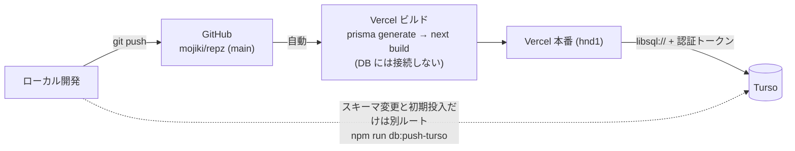

| やること | 手順 |
|---|---|
| 画面・ロジックの変更 | `git push` だけ。Vercel が自動ビルド・デプロイ（1〜2分） |
| スキーマ変更 | `schema.prisma` を編集 → `npm run db:migrate`（ローカルに migration を作る）→ Turso に `npm run db:push-turso`（§14.1 の 4）→ コードを `git push` |
| 環境変数の変更 | Vercel の Settings で変更 → **手動で Redeploy**（自動では反映されない） |
| バックアップ | **月1回、設定画面から CSV を2種類保存**。Turso 無料プランに自動バックアップは無い |
| 表示が遅い | Function Region と DB の地域を確認（§9.1、§18.1） |

**スキーマ変更の流れ**

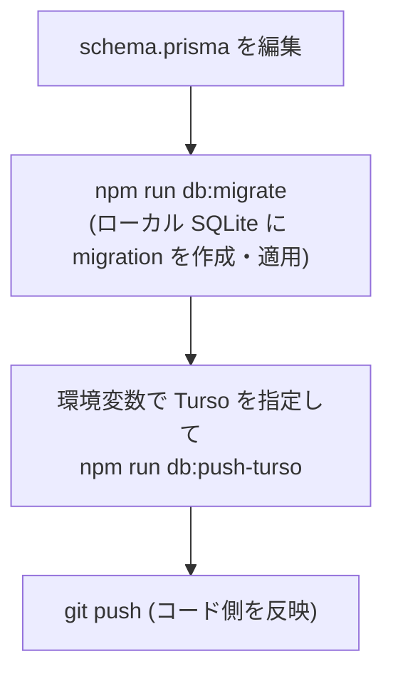

### 14.4 料金

| サービス | プラン | 月額 | 注意 |
|---|---|---|---|
| Vercel | Hobby | ¥0 | **個人・非商用のみ**。商用は Pro。帯域 100GB/月など上限あり（個人利用では問題にならない） |
| Turso | Free | ¥0 | 無料枠は広い。長期間アクセスが無いと DB がスリープ/アーカイブされることがある（再アクセスで復帰）。**無料枠の内容は変わりうる**ので年1回は確認 |
| GitHub | Free | ¥0 | private リポジトリも無料 |
| ドメイン | `*.vercel.app` | ¥0 | 独自ドメインは任意 |

### 14.5 アカウント・リポジトリの構成と注意

| 対象 | 現状 |
|---|---|
| GitHub | `mojiki/repz`（private）。残すアカウントは `mojiki`（`kimonji.monji@gmail.com`）。旧 `akanagi2` は削除予定 |
| Vercel | プロジェクト `repz`（スコープ `myapp21`、Hobby）。GitHub は `mojiki/repz` に接続 |
| Turso | アカウントは **`akanagi2` 名義**（組織 `akanagi2`、グループ `default`）。**`repz` のほか別アプリ「もけけ管理アプリ」の `mokeke` DB も同じアカウントにある** |
| Function Region | 東京 hnd1 |

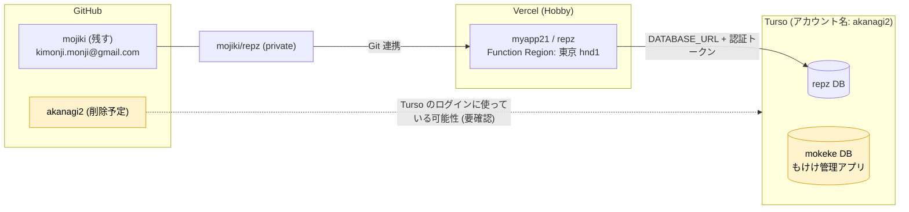

- **GitHub の `akanagi2` を削除する前に、Turso のログイン手段・組織メンバーを移行する**こと。`akanagi2` で Turso にサインインしている場合、削除すると repz と mokeke の両方の管理画面に入れなくなるおそれがある。
- **Vercel Hobby は「コミット作者のメール = Vercel アカウント本人」でないとデプロイがブロックされる**（"commit author doesn't have permission"）。`git config user.email` を Vercel 連携アカウントのメールに合わせる。名前（`user.name`）は問われない（実際に `mojiki` / `Moji` が混在しているが、メールは同じ）。
- Vercel は GitHub の接続先リポジトリ名に紐づく。**リポジトリを別アカウントへ移管したら、Settings → Git で接続先を張り替える**（古い `akanagi2/repz` のままだと push が届かない）。

---

## 15. 設計判断の記録

| ID | 判断 | 理由・経緯 |
|---|---|---|
| D-01 | 認証は Vercel の機能ではなく **`proxy.ts` で実装** | 初期の要件定義は「ホスティング側の機能で設定、コード実装不要」としていたが、同じ文書の実装メモは「`middleware.ts` に数行追加」とも書いており、後者のコード実装を採用した。環境変数が未設定なら無効（ローカル開発が楽）。ホスティング側の機能は使っていない |
| D-02 | **Prisma 7 ＋ libsql アダプタ**で、ローカルのファイルと Turso を同じコードで扱う | Prisma 7 は接続 URL を `prisma.config.ts` に置く。クライアントは `app/generated/prisma` に生成（コミットしない）。`postinstall` で再生成 |
| D-03 | Turso へのスキーマ適用は **`scripts/setup-turso.ts`** | `prisma migrate deploy` は `libsql://` に届かず P1013。migration SQL を libsql クライアントで直接適用し、`_prisma_migrations` にも記録（§14.2） |
| D-04 | **ビルドにマイグレーションを入れない** | Vercel の初回ビルドは環境変数が揃う前に走ることがあり、`migrate deploy` を含めると "Connection url is empty" で落ちた。スキーマ適用は手動の一度きりの作業にした |
| D-05 | **Prisma クライアントを遅延初期化（Proxy）** | Next はビルド時に各ルートを import して設定を集めるため、モジュール評価時に即 `DATABASE_URL` を要求するとビルドが落ちる。初回アクセス時に生成する |
| D-06 | **`include` を使わず、フラットなクエリを並列化**。保存の生 SQL `batch` 化は見送り | SQLite では `include` が別クエリ＝直列になる。表示時間は直列の往復数で決まる（§18.1）。リージョンを揃えた後は保存の往復差が小さく、Prisma を迂回する保守コストに見合わない |
| D-07 | 保存は **`revalidatePath("/", "layout")` ＋ サーバー側 `redirect`**。`revalidatePath` は残す | クライアントの `router.push` / `refresh` を重ねると、遷移前の画面の再描画や重複取得が発生していた。`staleTimes.dynamic` の既定は 0 秒だが**戻る/進むのキャッシュは別**（Next 同梱ドキュメント）。保存後に戻るで古いセット入力画面が出ると、古い値で保存して上書きする危険があるため、キャッシュ破棄のために `revalidatePath` を残す。**同ドキュメントは「全訪問ページを更新する現在の挙動は一時的で将来変わる」と明記**しているので、Next 更新時に再確認する |
| D-08 | `app/loading.tsx` を置く | 全画面 `force-dynamic` で、タップしてもサーバー応答まで何も変わらなかった。スケルトンで即座に反応を見せる |
| D-09 | **前回比は「直近トレ」ではなく「同じ種目の前回」** | 直近トレが別部位の日だと合計を比べても意味がない。プログレッシブオーバーロードは種目ごとに確認するもの |
| D-10 | 未達は赤にせず、中立の「あと◯kg」。超えたら緑 | トレ中は未達が普通で、ネガティブ表示は不要 |
| D-11 | PR 判定は**推定1RM（Epley）** | 重量だけ・回数だけだと、重量を下げて回数を増やした更新を拾えない |
| D-12 | 日付は文字列で扱い UTC 0 時で保存、「今日」は TZ オフセット env | サーバーが UTC のため。1人利用なので固定 TZ で十分 |
| D-13 | 種目の並び替えは ▲▼ ボタン（ドラッグ&ドロップにしない） | 設計書の「D&D 等」の範囲内。タッチ操作での確実性を優先 |
| D-14 | Top の「直近トレ」は `/recent` を経由せず直接 `/session/日付` へ | リダイレクトでリクエストが2回直列になっていた |
| D-15 | アプリ内ヘルプは**利用者向けのみ**。技術・運用は別文書 | URL を人に見せたとき、構成・版・アカウント名・環境変数が見えるのを避ける |
| D-16 | 種目は `(category, name)` を一意に | 同名の重複で選択肢が増えるのを防ぐ。seed も upsert で冪等になる |
| D-17 | 1日1セッション（`date` 一意）。複数回行った日は追記して統合 | 設計書の要件 |
| D-18 | 「← Topに戻る」をレイアウトで全ページ共通に | 記録の階層（大分類→種目→セット入力）が深く、上部の戻るリンクは1つ上にしか戻れない |
| D-19 | 設計書（要件）と README を **README.md に一本化**し、更新履歴を持たせる | 管理が分かれて統一できていなかったため（Rev.13） |

---

## 16. 既知の制約・落とし穴・不採用機能

### 16.1 トラブルシュート

| 症状 | 原因 | 対処 |
|---|---|---|
| `P1013 The provided database string is invalid` | `prisma migrate deploy` を Turso（`libsql://`）に対して実行した | `npm run db:push-turso` を使う（§14.2） |
| `P1012 The datasource property url is no longer supported` | Prisma 7 の schema に `url` を書いた | `prisma.config.ts` に移す |
| ビルドで `Connection url is empty` / `DATABASE_URL … 設定されていません` | ビルドに `migrate deploy` を含めていた／Prisma を即時生成していた | D-04・D-05。古いコミットを Redeploy していないかも確認 |
| Vercel: `commit author doesn't have permission` | コミットのメールが Vercel アカウントと不一致（Hobby） | `git config user.email` を合わせ、`git commit --amend --reset-author` → push |
| push しても Vercel が動かない | リポジトリを移管したのに Vercel の接続先が旧名のまま | Settings → Git を張り替え |
| `error: src refspec main does not match any` | ローカルのブランチが `master` | `git branch -m master main` |
| 型エラー `Type '"/…"' does not satisfy the constraint` | `PageProps` 等のルート型が未生成 | `next build`（または `next dev`）を一度実行 |
| 「保存する」後に古い画面が出る | `revalidatePath` を外した／キャッシュ | D-07 |
| 画面遷移が遅い | Function Region が DB から遠い／直列クエリが多い | §9・§18.1 |
| グラフが出ない | データが2点未満 | 記録を増やす |
| `npm run dev` で DB ファイルを消せない | dev サーバーや Prisma Studio が掴んでいる | その node プロセスだけを止める |
| `npm warn allow-scripts …`（Vercel ビルド） | npm がインストールスクリプトを許可リスト外として実行しない | 無害。`prisma generate` はビルドで明示実行され、実行時にネイティブエンジンは不要（Query Compiler 方式） |

### 16.2 既知の制約・未対応

- **全種目を個別に削除して空になったセッションが残る**（`deleteSessionExercise` は空セッションを掃除しない）。残ると「直近トレ」の最新が空のセッションになり、Top の直近トレが「まだ記録がありません」になりうる。
- `updateSet` / `deleteSet` は UI から未使用（予備）。
- 認証は共有 ID/PW 1組。ユーザー別データ分離なし。
- 自動バックアップなし（CSV を手動で保存）。
- `README.html`（エディタのエクスポート）は派生物で、更新されない。
- Next の `revalidatePath` の「訪問済みページを全更新する」挙動は一時的とされている（D-07）。
- 画面の自動テストは無い（§12.3 の手動チェックと §12.4 の HTTP 検証で担保している）。

### 16.3 不採用とした機能

- インターバルタイマー（次セットまでの休憩時間計測）
- オフライン対応（PWA 化・オフラインキャッシュ）
- lbs 単位切替
- 同一種目のウォームアップ／本セットの分別管理
- OAuth などの本格的な認証（Google 連携等）
- ライトテーマ

### 16.4 今後の候補（未実施）

- 空セッションの掃除（上記）と `updateSet` / `deleteSet` の整理
- セット入力に「保存して同じ部位へ」の副ボタン（部位を変えない日向け）
- 前回比を「同じメニュー（テンプレート）の前回」でも見る
- libsql 接続を `https://`（ステートレス HTTP）にする実験（効果は実測が必要）
- 画面の E2E テスト

---

## 17. 更新履歴

新しい順。**区分**: 機能／改善／修正／構成／運用／文書。コミットは短縮ハッシュ（日付は作者日）。

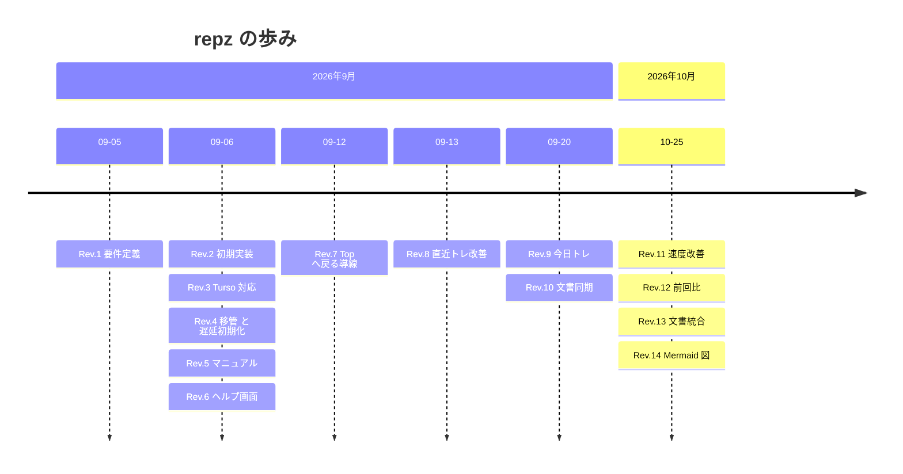

### Rev.14 — 2026-10-25 · `b1423c9`

| 区分 | 内容 | 理由・影響 |
|---|---|---|
| 文書 | **Mermaid 図を 19 点追加**: 構成、リクエストの流れ（表示・保存）、モジュール依存、ER、セッションのライフサイクル、前回値の決め方、前回比の判定、画面遷移（2 枚）、`saveSets` のフロー、セット入力のクエリ前後比較（2 枚）、認証の判定、初回構築・デプロイ・スキーマ変更の流れ、アカウント構成、更新履歴のタイムライン。§3.1 と §5.1 の ASCII 図は Mermaid に置き換え | 文章と表だけでは構造や流れが追いにくかった。GitHub 上でそのまま描画される。図の更新も更新ルール（§0.3 の 6）に追加 |

### Rev.13 — 2026-10-25 · `06714d0`

| 区分 | 内容 | 理由・影響 |
|---|---|---|
| 文書 | **README.md と `docs/設計ドキュメント.md` を README.md に統合**し、ゼロから再構築できる仕様書として全面改訂。更新履歴（本章）を追加。`docs/設計ドキュメント.md` は削除 | 要件定義と README に分かれて管理が統一できていなかった。以後は本書が唯一の仕様の正（`docs/repz-manual.html` は別管理で継続） |
| 運用 | **Vercel の Function Region を 大阪 kix1 → 東京 hnd1 に変更** | DB（Turso: AWS 東京）と同じ地域に揃え、DB 往復をさらに短くする。反映は再デプロイ時。コード変更なし |
| 文書 | `prisma/schema.prisma` 先頭コメントの参照先を本書に変更。`docs/repz-manual.html` の Function Region の記述を現状（東京）に更新 | 旧設計ドキュメント廃止に伴う参照の整合 |

### Rev.12 — 2026-10-25 · `dc7d551`

| 区分 | 内容 | 理由・影響 |
|---|---|---|
| 機能 | **保存後の遷移先を Top に変更**（過去日の編集は `/session/日付` に戻す） | トレ後は別の部位へ移ることが多いため。`saveSets` がサーバー側 `redirect` で遷移し、遷移先は `safePath` で検証 |
| 機能 | **今日トレに「同じ種目の前回」との比較を追加**（種目ごとの `▲ +◯kg` / `あと ◯kg` / `初回`、合計の前回比＋進捗バー、2行レイアウト） | プログレッシブオーバーロードを確認したい。直近トレは別部位のことがあるため、比較対象は種目ごとの前回（D-09） |
| 機能 | **セット入力画面に「この種目 前回◯kg → あと◯kg」を固定表示**（入力に合わせて更新） | トレ中にいちばん使える場所で前回超えを確認できる |
| 構成 | `getPreviousExerciseTotals`、`VolumeProgress`、`lib/format.ts`、`compareVolume` を追加。`DayTrainingCard` に前回比モード | 前回の取得はリレーションフィルタで他クエリと並列（Top の直列段数は増えない） |
| 文書 | `/help`・README・設計ドキュメント・マニュアルを更新 | |

### Rev.11 — 2026-10-25 · `8e2ec58`

| 区分 | 内容 | 理由・影響 |
|---|---|---|
| 改善 | **レスポンス改善**: `app/loading.tsx`（スケルトン）、`lib/queries.ts` を `include` 廃止＋並列化、保存を1アクションで `redirect` 完結、不要な `router.refresh()` を全削除、Top の「直近トレ」を直リンク化 | 実測で、描画は 5〜12ms、遅さの正体は「直列の DB 往復 × DB との距離」（§18.1）。画面あたりの直列往復 3〜5 → 1〜2、保存は DB 呼び出し 17 回（直列約11段）→ 6 回。旧実装との戻り値は 403 通りの比較で完全一致 |
| 構成 | `saveSets` のシグネチャを `(dateStr, exerciseId, rows, memo, redirectTo)` に変更し、メモ保存を統合。`getOrCreateSession` / `getCategories` を削除 | 往復削減。`updateSessionMemo` も upsert 1回に |
| 構成 | `getExercisePR` の第2引数を「除外セットID配列」→「除外する日付」に変更 | 今日のセット取得を待たずに並列化するため |
| 文書 | 性能調査の記録を §18 に追加 | |

### Rev.10 — 2026-09-20 · `527068e`

| 区分 | 内容 | 理由・影響 |
|---|---|---|
| 文書 | README・設計ドキュメント・マニュアル・`/help` を今日トレ・`/help`・Top に戻る導線・Turso 手順に合わせて更新。設計ドキュメントの認証・マイグレーションの記述を実装に合わせて訂正 | 実装との乖離の解消 |

### Rev.9 — 2026-09-20 · `30ecec0`

| 区分 | 内容 | 理由・影響 |
|---|---|---|
| 機能 | **Top に「今日トレ」を追加**し、順序を 今日トレ → 直近トレ → 今週のボリューム → 体重 に変更 | 今日保存した内容をすぐ確認したい。保存するまでは非表示 |
| 構成 | 今日トレ／直近トレの表示を `components/DayTrainingCard.tsx` に共通化 | 同じ形式の表示が2か所になったため |

### Rev.8 — 2026-09-13 · `97fe23f`, `8aa8d59`

| 区分 | 内容 | 理由・影響 |
|---|---|---|
| 修正 | 直近トレの種目行を `◯set / ◯kg` → **`最大重量◯kg / トータル◯kg`**（トータル＝重量×回数の合計） | セットごとに重量・回数が違うと「セット数と最大値」だけでは実態を表さない |
| 機能 | 直近トレに **「その日のトータル ◯kg」**（全種目合計）を追加 | |

### Rev.7 — 2026-09-12 · `032c871`

| 区分 | 内容 | 理由・影響 |
|---|---|---|
| 機能 | **全ページ下部に「← Topに戻る」**（`BackToTop`、レイアウトで共通化。Top では非表示） | 記録の階層が深く、上部の戻るリンクだと Top まで何度も戻る必要があった（D-18） |

### Rev.6 — 2026-09-06 · `4473621`

| 区分 | 内容 | 理由・影響 |
|---|---|---|
| 機能 | **アプリ内ヘルプ `/help`**（利用者向けの使い方のみ）。ヘッダーに「使い方」リンク | 使い方をアプリ内で見たい。技術情報は載せない（D-15） |

### Rev.5 — 2026-09-06 · `fb148f4`

| 区分 | 内容 | 理由・影響 |
|---|---|---|
| 文書 | **運用マニュアル `docs/repz-manual.html`** を追加（使い方・技術スタック・構成図・料金と注意・トラブル対処）。Artifact としても公開 | 後から自分が困らないための運用メモ |

### Rev.4 — 2026-09-06 · `a41f215`, `4698826`

| 区分 | 内容 | 理由・影響 |
|---|---|---|
| 修正 | **Prisma クライアントを遅延初期化**（Proxy）。再デプロイ用の空コミット | Vercel のビルドで `DATABASE_URL` 未設定のとき、ルート設定収集のモジュール評価で落ちた（D-05） |
| 運用 | **GitHub リポジトリを `akanagi2/repz` → `mojiki/repz` に移管**。Vercel を `mojiki/repz` で取り込み直し。のちに、Vercel の Git 接続先が旧 `akanagi2/repz` のままで push が届いていないことが分かり（Rev.6 の反映確認時）、Settings → Git で張り替えた | 残すアカウントを `mojiki` に統一するため。移管後は Vercel が旧名を見続けて push が届かなかった（§14.5） |
| 運用 | Vercel Hobby の「コミット作者ブロック」への対処（作者メールを Vercel アカウントに合わせる） | Hobby は作者がアカウント本人でないとデプロイしない（§14.5） |

### Rev.3 — 2026-09-06 · `4a55339`, `94d6a0d`, `7d33c75`, `9e5b56c`, `76309f4`, `906e5dd`

| 区分 | 内容 | 理由・影響 |
|---|---|---|
| 構成 | `db:sql`（DDL 出力）を追加 | |
| 構成 | ビルドに `prisma migrate deploy` を入れた（`94d6a0d`）→ **後に撤回**（`76309f4`） | 環境変数が揃う前の初回ビルドが "Connection url is empty" で失敗（D-04） |
| 構成 | `prisma.config.ts` で `DATABASE_AUTH_TOKEN` を URL の `?authToken=` に畳み込み（`7d33c75`） | schema engine は adapter を使わず URL しか見ない |
| 構成 | `TURSO_DATABASE_URL` / `TURSO_AUTH_TOKEN` でも動くように（`9e5b56c`、`lib/db-env.ts`） | Vercel の Turso 連携が入れる環境変数名に合わせる |
| 構成 | **`scripts/setup-turso.ts` で Turso にスキーマを適用**、`db:push-turso` を追加（`906e5dd`） | `prisma migrate deploy` が `libsql://` で P1013 になるため（D-03） |

### Rev.2 — 2026-09-06 · `de4e840`（雛形 `11420b3`）

| 区分 | 内容 | 理由・影響 |
|---|---|---|
| 機能 | **初期実装**: 種目選択、セット入力（前回値初期化・ステッパー・セットコピー・PR バッジ・メモ）、Top（記録導線・週間ボリューム・直近トレ・体重）、セッション詳細（編集・削除・追記）、週間ボリューム詳細、種目別グラフ、体重、設定（種目の追加・改名・並び替え・削除、テンプレート）、CSV エクスポート、Basic 認証（`proxy.ts`） | Rev.1 の要件を実装 |
| 構成 | Next.js 16 ＋ Prisma 7 ＋ `@prisma/adapter-libsql`（ローカルは SQLite ファイル）。create-next-app の雛形から作成 | Prisma 7 の仕様（`url` は `prisma.config.ts`）に合わせた |
| 構成 | `exercises(category, name)` の一意制約と冪等 seed（初期 38 種目）。`middleware.ts` を Next 16 の `proxy.ts` に改名 | 同名の重複防止。Next 16 の命名変更 |

### Rev.1 — 2026-09-05（要件定義）

| 区分 | 内容 |
|---|---|
| 文書 | 設計ドキュメント初版（現在は本書に統合）。目的（ジムでスマホから記録・前回比較・週間ボリューム・体重）、技術スタック（Next.js / Turso / Prisma / Vercel / Basic 認証）、データモデル6テーブル、画面構成、主要機能、不採用機能を定義 |

---

## 18. 付録

### 18.1 性能調査の記録（Rev.11）

**問い**: ボタン押下から次の画面までが遅い。原因はどこか、課金が必要か。

**方法**: 本番ビルドを手元で起動し、Prisma のアダプタを包んで **DB 呼び出し1回ごとに遅延を注入**（§18.2）。アプリのコードは変えずに、各画面の「クエリ数」「直列の往復数」「完了時間」を測った。往復数は `(往復150ms時の時間 − 0ms時の時間) / 0.15` で求める。

**結果（変更前）**

| 画面 | クエリ数 | 直列の往復 | 往復0ms | 往復150ms |
|---|---|---|---|---|
| Top | 11 | 3 | 0.012s | 0.48s |
| 記録 > 大分類 | 5 | 3 | 0.006s | 0.48s |
| 記録 > 種目一覧 | 1 | 1 | 0.005s | 0.17s |
| セット入力 | 8 | **5** | 0.008s | **0.79s** |
| セッション詳細 | 3 | 3 | 0.006s | 0.48s |
| 体重 | 1 | 1 | 0.005s | 0.16s |
| 使い方（DBなし） | 0 | 0 | 0.002s | 0.002s |

- 描画自体は 5〜12ms。**遅さの正体は直列の DB 往復 × 距離**。
- 「保存する」は、アクション内で直列6回（SELECT → BEGIN → DELETE → INSERT → COMMIT → COUNT）に加え、`revalidatePath` が遷移前の画面（直列4〜5回）を裏で再描画し、さらに `router.push` と `router.refresh` で重複取得。**合計 17 呼び出し・直列約11段**。
- 初回リクエストは手元でも 0.25s（通常の約20倍）。アイドル後の初回はこの初期化コスト。
- `loading.tsx` が無く、タップしてもサーバー応答まで画面が変わらなかった。

**構成の事実**: Turso = AWS ap-northeast-1（東京）。Vercel の Function Region は当初 大阪 kix1 → 東京 hnd1（Rev.13）。

**対策と結果（変更後。往復150ms）**

| 画面 | 直列の往復 | 完了時間 |
|---|---|---|
| Top | 3 → 2 | 0.48s → 0.32s |
| セット入力 | 5 → 2 | 0.79s → 0.32s |
| 大分類・セッション詳細・設定・種目別グラフ・週間ボリューム | 3/2 → 1 | 0.48s/0.33s → 約0.17s |

保存: DB 呼び出し 17 → 6、直列約11段 → 6段。

**課金の要否**: 不要と判断。Vercel Pro も Turso 有料も、原因（距離と往復数）には効かない。

**検証の限界**: 検証用ブラウザペインは `requestAnimationFrame` が止まることがあり、ストリーミングの差し替えとハイドレーションの確認に使えない時があった。サーバー応答（最初のバイトが約5ms）と、アクションの HTTP 直接呼び出し（§12.4）で補った。

### 18.2 計測ハーネスの作り方（再現用）

アプリのコードを変えずに DB 往復へ遅延を入れる方法。

1. `lib/prisma.ts` は `globalThis.prisma` があればそれを使う。計測用の preload でここに **遅延入りのクライアント**を入れる。
2. `PrismaLibSql` のインスタンスを `Proxy` で包み、`connect()` が返すドライバの `queryRaw` / `executeRaw` / `executeScript` / `commit` / `rollback` と `startTransaction` を、**呼び出しごとに「ログ追記 → 遅延ファイルの値だけ `await sleep`」**するラッパーに差し替える（トランザクションオブジェクトも再帰的に包む）。遅延は `latency.txt` を毎回読むので、サーバーを再起動せずに変えられる。
3. `NODE_OPTIONS="--import tsx --import ./_perf/preload.ts" npx next start -p 3100` で本番ビルドを起動。
4. `curl -w "%{time_total}"` を画面ごとに数回打ち、ログの行数の増分＝クエリ数、遅延 0 と 150 の差＝直列の往復数を出す。ストリーミングのため **TTFB ではなく `time_total`** で測る。
5. リファクタ前後の結果は、旧実装（`git show HEAD:lib/queries.ts`）と新実装の関数を同じ DB に呼んで **戻り値の深い比較**で確認した（画面の HTML 比較は、ストリーミングで出力順が変わるため不向き）。
6. 計測後は一時ディレクトリ・テストデータを必ず片付ける。

### 18.3 用語

| 用語 | 意味 |
|---|---|
| ボリューム | 重量 × 回数の合計（kg） |
| 推定1RM | Epley 式で求めた、1回だけ挙げられる推定の最大重量 |
| PR | 自己ベスト更新 |
| 今日トレ / 直近トレ | 今日のセッション / 今日より前で最新のセッション |
| 同種目の前回 | その種目を、その日より前に最後に行った日 |
| セッション | 1日ぶんのトレーニング記録（`workout_sessions` の1行） |
| Proxy | Next.js 16 での旧 middleware の名称（`proxy.ts`） |
| libSQL / Turso | SQLite 互換のデータベースと、そのクラウドサービス |
